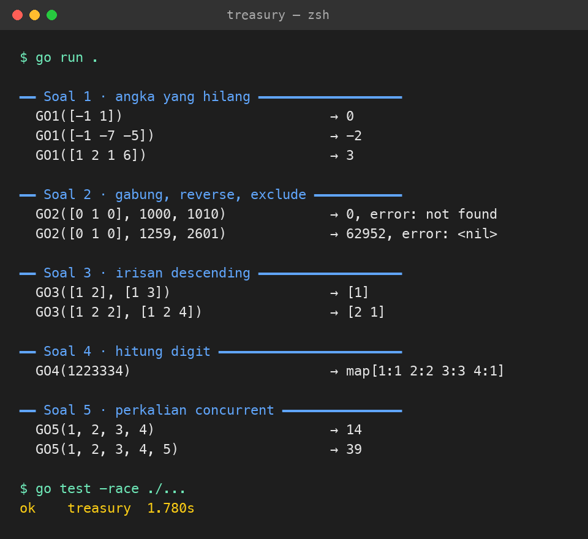

# Golang Coding Test

Lima soal fungsi Golang. Kode ada di [`main.go`](main.go), test di [`main_test.go`](main_test.go).

## Cara menjalankan

Butuh Go 1.22+.

```bash
cd treasury   # dari root repo
go run .            # menampilkan hasil semua contoh soal
go test -race ./... # menjalankan unit test (termasuk race detector untuk soal 5)
```

Output `go run .`:

```
━━ Soal 1 · angka yang hilang ━━━━━━━━━━━━━━━━━━
  GO1([-1 1])                          → 0
  GO1([-1 -7 -5])                      → -2
  GO1([1 2 1 6])                       → 3

━━ Soal 2 · gabung, reverse, exclude ━━━━━━━━━━━
  GO2([0 1 0], 1000, 1010)             → 0, error: not found
  GO2([0 1 0], 1259, 2601)             → 62952, error: <nil>

━━ Soal 3 · irisan descending ━━━━━━━━━━━━━━━━━━
  GO3([1 2], [1 3])                    → [1]
  GO3([1 2 2], [1 2 4])                → [2 1]

━━ Soal 4 · hitung digit ━━━━━━━━━━━━━━━━━━━━━━━
  GO4(1223334)                         → map[1:1 2:2 3:3 4:1]

━━ Soal 5 · perkalian concurrent ━━━━━━━━━━━━━━━
  GO5(1, 2, 3, 4)                      → 14
  GO5(1, 2, 3, 4, 5)                   → 39
```



Karena Go tidak mengizinkan beberapa fungsi bernama `GO` dalam satu package, fungsinya dinamai `GO1`..`GO5` sesuai nomor soal.

## Penjelasan soal dan solusi

### 1. `GO1(arr []int) int`
- Campuran negatif dan positif: `0`.
- Hanya positif: bilangan positif terkecil yang **tidak ada** di `arr` (`[1,2,1,6]` → `3`).
- Hanya negatif: bilangan negatif terbesar yang **tidak ada** di `arr` (`[-1,-7,-5]` → `-2`).
- Angka `0` diabaikan.

Catatan: teks soal menyebut "terkecil/terbesar", tetapi contohnya hanya cocok dengan tafsiran "angka yang hilang" di atas, jadi itu yang dipakai.

Pendekatan: satu kali lewat untuk membuat set dan menandai ada tidaknya angka positif/negatif. Lalu hitung `1,2,3,...` (atau `-1,-2,...`) sampai ketemu yang tidak ada di set. Kompleksitas O(n).

### 2. `GO2(exclude []int, nums ...int) (int, error)`
Gabungkan semua angka menjadi satu deret digit, balik urutannya, lalu buang digit yang ada di `exclude`.
- `GO2([]int{0,1,0}, 1259, 2601)`: `"12592601"` → balik `"10629521"` → buang `0` dan `1` → `62952`.
- Jika semua digit terbuang, hasilnya `0` dan error `"not found"`.

Pendekatan: digit `exclude` disimpan di set, string dibaca dari belakang (otomatis ter-reverse), lalu digit yang terlarang dilewati. Leading zero hilang saat `Atoi`.

### 3. `GO3(numsA, numsB []int) []int`
Irisan `numsA` dan `numsB`, tanpa duplikat, urut menurun (`[1,2,2]` & `[1,2,4]` → `[2,1]`).

Pendekatan: `numsB` dijadikan set. `numsA` disaring dan dideduplikasi dengan set kedua, lalu diurutkan descending. Kompleksitas O(n log n) karena sorting.

### 4. `GO4(num int) map[int]int`
Pecah angka menjadi digit dan hitung berapa kali tiap digit muncul (`1223334` → `1:1, 2:2, 3:3, 4:1`).

Pendekatan: ambil digit dengan `num % 10`, geser dengan `num / 10`. Angka negatif memakai nilai mutlaknya. `0` ditangani khusus (`{0:1}`).

### 5. `GO5(nums ...int) int`
Kalikan pasangan (index 0×1, 2×3, ...) secara concurrent lalu jumlahkan. Elemen terakhir tanpa pasangan dikali dirinya sendiri (`[1,2,3,4,5]` → `1*2 + 3*4 + 5*5 = 39`).

Pendekatan: satu goroutine per pasangan mengirim hasil ke buffered channel. Main thread menerima tepat sebanyak jumlah pasangan dan menjumlahkannya. Ukuran buffer sama dengan jumlah pasangan, jadi goroutine tidak pernah tertahan. Jumlah goroutine adalah `ceil(len/2)`: 2 untuk 4 angka, 3 untuk 5 angka.
